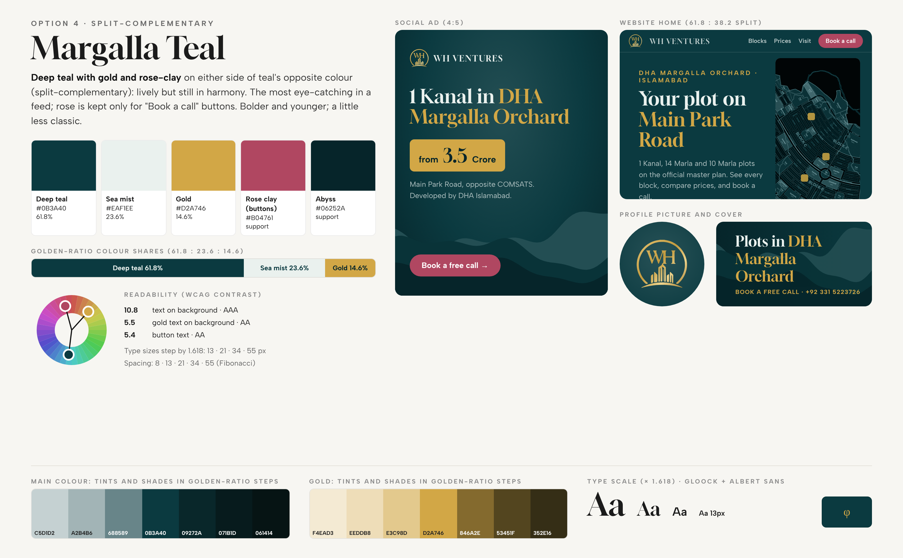

# WH Ventures brand standard: Margalla Teal

Chosen on 9 Nov 2026. One colour standard for **everything**: social media profiles and covers, all ads and videos,
the website, the sales system, letterheads and the client offer.

## The colours

| Role | Name | Hex | Share | Use it for |
|---|---|---|---|---|
| Main | **Deep teal** | `#0B3A40` | 61.8% | Backgrounds, hero sections, headers, ad backgrounds |
| Second | **Sea mist** | `#EAF1EE` | 23.6% | Light pages and cards; headline text on teal |
| Accent | **Gold** | `#D2A746` | 14.6% | The logo, prices, key words in headlines, thin lines |
| Support | **Abyss** | `#06252A` | – | Footers, the darkest hills, text on gold |
| Action | **Rose clay** | `#B04761` | – | **Only** the call-to-action buttons ("Book a call", "WhatsApp us"), always with white text |
| Text | **Sage** | `#A9C4C4` | – | Body text on teal |
| Text | **Slate** | `#4A6B6E` | – | Body text on sea mist |
| Text | **Gold ink** | `#7A5F22` | – | Gold-coloured words on sea mist (plain gold is too light there) |

### Why these colours (colour theory)
- **Split-complementary harmony.** Teal sits at 187° on the colour wheel. Its opposite is 7° (red). Gold (42°) and
  rose (346°) sit about 30° either side of that opposite. This gives strong contrast without the clash of a direct
  opposite.
- **Teal** = calm, trust, the Margalla Hills and water. **Gold** = value and the logo. **Rose** = warmth and action,
  so the eye goes to the button.

### Golden ratio (φ = 1.618)
- **Colour shares:** 61.8% teal, 23.6% mist, 14.6% gold. Each share is 0.618 of the one before it, after the first
  split. Rose stays under 5%: only on buttons.
- **Text sizes** grow by ×1.618: 13 · 21 · 34 · 55 · 89 px.
- **Spacing** uses Fibonacci numbers: 8 · 13 · 21 · 34 · 55 · 89 px.
- **Layouts** split 61.8 : 38.2 (for example, the website hero: text on the left 61.8%, map on the right 38.2%).
- **Tints and shades** step by 0.618 toward white or black (see `tokens.css`).

### Readability (WCAG contrast, checked)
| Pair | Ratio | Grade |
|---|---|---|
| Sea mist on deep teal | 10.8 | AAA |
| Gold on deep teal | 5.5 | AA |
| Gold on abyss | 7.2 | AAA |
| White on rose clay (buttons) | 5.4 | AA |
| Sage on deep teal (body text) | 6.7 | AA |
| Gold ink on sea mist | 5.3 | AA |
| Slate on sea mist | 5.1 | AA |

**Never:** rose text on teal (2.3, unreadable), plain gold text on sea mist (too light), more than one rose element
per screen or ad.

## Fonts
- **Gloock**: headlines and the "WH VENTURES" wordmark.
- **Albert Sans**: everything else.

Both are free on Google Fonts.

## Logo
`wh-emblem.svg`: the gold WH emblem, traced from the original as a vector, so it stays sharp at any size. Put it on
deep teal or abyss. On sea mist, it still works, but keep it large (at least 34 px).

## Files
- `tokens.css`: CSS variables for the website and the sales system.
- `tokens.json`: the same values for scripts (ad renderers, video tools).
- `wh-emblem.svg`: the logo.
- `../social-media/color-themes/`: the four options that were compared, and how they were built.
